<nav class="post-nav" aria-label="論文の各節へ移動">
  <p class="post-nav-title">論文</p>
  <ul>
    <li><a href="#sheared-llama">1. Sheared LLaMA</a></li>
    <li><a href="#flap">2. FLAP</a></li>
    <li><a href="#slicegpt">3. SliceGPT</a></li>
    <li><a href="#minitron">4. Minitron</a></li>
  </ul>
</nav>

<figure class="diagram">
  
  <figcaption>矢印は「引用する論文 → 引用される論文」です。日付はarXiv初稿の投稿日です。対象4本の間の直接引用のみを示し、FLAP（破線の枠）と他の3本の間には引用が見当たりません。確認した版はFLAPがv1、他の3本がv2です。<a class="citation" href="#ref-1">[1]</a><a class="citation" href="#ref-2">[2]</a><a class="citation" href="#ref-3">[3]</a><a class="citation" href="#ref-4">[4]</a></figcaption>
</figure>

学習済みの大きなLLMから、層や内部の次元を削って小さなモデルを作ることを考えます。個々の重みをゼロにしても、通常のdenseな行列積では行列の形状は変わりません。一方、層・attention head・チャネルなどのまとまりを取り除く構造化プルーニングでは、小さなdense行列として計算できるモデルを作れます。その際、何を残せばよいのか、失った成分の寄与をどう補うのかが問題になります。以下の4本は、この二つの問題への取り組み方が異なります。特に、構造と重みの一部を引き継ぐプルーニングと、teacherの出力や中間表現をstudentに学ばせる知識蒸留は別の操作であり、この4本ではMinitronが両者を組み合わせます。<a class="citation" href="#ref-1">[1]</a><a class="citation" href="#ref-2">[2]</a><a class="citation" href="#ref-3">[3]</a><a class="citation" href="#ref-4">[4]</a>

## 1. Sheared LLaMA：目標の形状に削ってから学習する {#sheared-llama .post-section tabindex="-1"}

Sheared LLaMAの問いは、大きなモデルの重みを再利用すれば、小さなモデルを最初から事前学習する費用を減らせるか、というものです。LLaMA2-7Bから1.3Bと2.7Bのモデルを作り、構造を削る段階と、小さくしたモデルの継続事前学習を分けます。ここでBは10億を表し、モデル名ではパラメータ数、学習量ではtoken数に使います。圧縮直後に元モデルと同じ性能を保つことだけを狙うのではなく、切り出した重みを小型モデルの有効な初期値として利用する設計です。<a class="citation" href="#ref-1">[1]</a>

### 1.1 形状を指定し、残す要素をマスクで選ぶ

「パラメータを半分にする」という条件だけでは、層数を減らすのか、各層の幅を減らすのかは決まりません。Sheared LLaMAは、完成後の層数・隠れ状態の幅・head数・MLPの中間次元をあらかじめ指定します。隠れ状態の幅は層をまたいで受け渡すベクトルの次元で、MLPの中間次元は各層のfeed-forward network内部で一度広げる次元です。両者は別々に削減できます。たとえばMLPの中間ニューロンを削るときは、その値を作る射影と、その値を入力として受け取る射影の対応する行・列を一緒に取り除きます。こうした構造の単位ごとにマスクを置き、どの要素を残すかを学習します。<a class="citation" href="#ref-1">[1]</a>

例として、ある層の32個のheadから20個を残す場合を考えます。headごとのマスクを \(z_h\)、残す目標数を \(H_*=20\) とすると、論文では言語モデル損失に次のような制約項を加えます。

<div class="math-scroll">
\[
\mathcal{L}_{\mathrm{head}}=\lambda\left(\sum_h z_h-H_*\right)+\phi\left(\sum_h z_h-H_*\right)^2.
\]
</div>

\(z_h=0\) は削除、\(z_h=1\) は保持を表し、\(\lambda,\phi\) は目標数への制約に用いるLagrange乗数です。学習中のマスクは、0と1に確率質量を持ちながら連続的な値も取れるhard concrete分布で表現し、元モデルの重みとともに最適化します。層数や他の次元にも同様の制約を課し、最後にマスクの値に基づいて指定数の要素を残します。つまり、「何個残すか」は形状の指定、「どれを残すか」は学習が担います。<a class="citation" href="#ref-1">[1]</a>

論文のTable 8にある2.7Bモデルの形状を見ると、この区別が具体的になります。32層は維持したまま、層の幅と内部の構造を削っています。1.3Bモデルでは層数も24に減らします。headごとの次元は元モデルの128を継承するため、既存の小型モデルの形状を参考にしていても、その構成を何でもそのまま再現できるわけではありません。<a class="citation" href="#ref-1">[1]</a>

| 項目 | LLaMA2-7B | Sheared-LLaMA-2.7B |
| --- | --- | --- |
| 層数 | 32 | 32 |
| 隠れ状態の次元 | 4096 | 2560 |
| 各層のhead数 | 32 | 20 |
| headごとの次元 | 128 | 128 |
| MLPの中間次元 | 11008 | 6912 |

### 1.2 残っている知識に合わせて学習データを配分する

マスクを確定した後は、小さなモデルを通常の次token予測で継続事前学習します。ただし、プルーニング後のモデルがすべての分野を同じ程度に忘れているとは限りません。そこでdynamic batch loadingでは、コード、Web文書、書籍などのdomainごとに検証損失を測り、参照損失からの遅れが大きいdomainに多くのデータを配分します。標準の設定では、複数サイズのLLaMA2の損失からscaling lawを当てはめ、目標サイズのモデルの参照損失を推定します。元モデルの損失を参照にする設定も評価しています。<a class="citation" href="#ref-1">[1]</a>

たとえば、二つのdomainの現在の損失がともに2.5でも、参照値が2.4と2.0なら、目標からの遅れは0.1と0.5です。論文の更新則は、現在のサンプリング重みに、この正の損失差の指数を掛けて正規化します。最初の比率が等しいなら、この例では次の比率は約40対60になり、後者を多く読み込みます。単純に損失が大きいdomainを選ぶのではなく、それぞれの到達目標との差を使うわけです。参照モデルを使っていても、ここで与えているのはデータ配分の基準であり、tokenごとの出力分布を一致させる蒸留の教師信号ではありません。<a class="citation" href="#ref-1">[1]</a>

主実験では、マスクの探索に0.4B token、継続事前学習に50B tokenを使用し、データにはRedPajamaを使います。Table 2の10-shot HellaSwag正解率は、Sheared-LLaMA-2.7Bが70.8%、比較対象のOpenLLaMA-3B-v2が67.6%、元のLLaMA2-7Bが78.6%です。この結果は、元モデルの全能力を保ったというより、既存の重みから同規模の小型モデルに対して競争力のあるモデルを育てられた、と読むのが適切です。また、50B tokenは小型版を作る追加学習量であり、元の7Bモデルの事前学習費用は別に存在します。<a class="citation" href="#ref-1">[1]</a>

## 2. FLAP：削った成分の平均的な寄与をbiasで補う {#flap .post-section tabindex="-1"}

FLAPは、再学習を行わずに構造を削ることを目指します。あるチャネルの値が大きくても、入力が変わったときにほとんど変動しないなら、その寄与を定数で置き換えられるかもしれません。この「削除した後に補いやすいか」という観点から重要度を決め、削った成分の平均的な寄与を追加のbiasで補います。対象は線形層の入力チャネルに対応する重みの列で、attentionではheadに対応するチャネルをまとめて扱います。活性値の統計を測る少量のcalibration dataを使いますが、勾配による重みの再学習は行いません。<a class="citation" href="#ref-2">[2]</a>

### 2.1 重要なのは大きさだけでなく、平均からの変動

一つの線形層を \(y=Wx\) と書きます。\(x\in\mathbb{R}^{d}\) は入力の列ベクトル、\(W\in\mathbb{R}^{m\times d}\) は重みで、第 \(j\) 列を \(w_j\in\mathbb{R}^{m}\) とすると、出力への寄与は \(w_jx_j\) です。第 \(j\) チャネルの平均を \(\mu_j\)、残すチャネルの集合を \(K\)、削る集合を \(D\) とすると、FLAPのbias補償は次の形に整理できます。

<div class="math-scroll">
\[
\widehat{y}=\sum_{j\in K}w_jx_j+b,\qquad b=\sum_{j\in D}w_j\mu_j.
\]
</div>

平均 \(\mu_j\) はcalibration dataから求めます。\(b\) は入力によらない \(m\) 次元のベクトルなので、推論時には削ったチャネルを計算せず、残った線形層の出力に加えれば済みます。既存のbiasがあれば、この補償分を加えます。たとえば、ある成分が9.9と10.1の間で変動し、その重みが2なら、元の寄与は19.8または20.2です。単に削るとこの寄与をすべて失いますが、平均から作ったbiasの20を加えれば、誤差はそれぞれ−0.2、0.2に収まります。これは仕組みを示すための数値例で、論文の測定値ではありません。<a class="citation" href="#ref-2">[2]</a>

この例を一般化すると、一つのチャネルを平均値で置き換えた場合の誤差は \(w_j(x_j-\mu_j)\) です。入力分布に対する二乗誤差の期待値は、次のようになります。

<div class="math-scroll">
\[
\mathbb{E}\!\left[\lVert w_j(x_j-\mu_j)\rVert_2^2\right]=\operatorname{Var}(x_j)\lVert w_j\rVert_2^2.
\]
</div>

FLAPのfluctuation metricは、この関係に沿って、活性値の標本分散に対応する重み列の二乗ノルムを掛けます。変動が小さいほど定数で置き換えやすく、同じ変動でも重みが大きければ出力誤差が増えるためです。平均的な値の大きさではなく、補償後に残る変動を測っている点が重要です。ただし、複数チャネルを同時に削ると、誤差同士の相関も全体の誤差に影響します。この一成分の式から、個別スコアの和がネットワーク全体の損失を厳密に表すとは言えません。<a class="citation" href="#ref-2">[2]</a>

### 2.2 層ごとの削減量も統計から決める

層やattention・MLPなどのmoduleが違うと、重要度スコアの分布も異なります。FLAPでは各層・moduleのスコアを平均と標準偏差で標準化して比較し、全体の削減予算に合わせて削る構造を決めます。その結果、各層を一律に20%削るような設定に固定せず、層・moduleごとの削減量を変えられます。標準化後のスコアは、その場所で相対的にどれだけ重要かを表すので、すべての層の絶対的な出力誤差を同じ尺度で最小化している、という意味ではありません。目標の形状を先に固定するSheared LLaMAとは、形状を決める段階が異なります。<a class="citation" href="#ref-2">[2]</a>

論文のTable 2では、LLaMA-7Bを20%プルーニングしたFLAPの7種類の常識推論タスクの平均正解率は62.08%で、元モデルの63.25%に近い値です。一方、50%プルーニングでは50.37%まで下がります。再学習なしで圧縮できることと、大きく削っても能力が維持されることは別です。biasが表せるのは削った成分の平均的な寄与なので、入力によって変わる情報を回復するには限界があります。また、平均や分散をcalibration dataから推定する以上、その統計が利用時の入力をどの程度代表しているかも関係します。<a class="citation" href="#ref-2">[2]</a>

## 3. SliceGPT：削る前に表現の座標系を変える {#slicegpt .post-section tabindex="-1"}

FLAPは元の座標でチャネルを選びますが、情報が複数の座標に分散していれば、そのまま一つの座標を削るのは難しくなります。SliceGPTは、少数の方向に情報が集まるように内部表現の座標系を回転させてから、寄与の小さい方向を取り除きます。削る中心はTransformerのblock間を流れる隠れ状態の幅です。MLPの中間ニューロンやattention headを直接選ぶ操作とは異なり、その隠れ状態を入出力とする重みの行・列を対応して小さくします。<a class="citation" href="#ref-3">[3]</a>

### 3.1 回転は等価変換、次元の削除は近似

入力が常に \(x=(a,a)^\top\) という二次元の例を考えます。二つの成分は同じ情報を持っていますが、第二成分を削ってゼロで埋めると \((a,0)^\top\) となり、元のベクトルとの二乗誤差は \(a^2\) です。一方、軸を45度回して \((\sqrt{2}a,0)^\top\) と表せば、ゼロの方向を削っても元のベクトルを復元できます。「どの座標を残すか」と「どの部分空間を残すか」の違いがここにあります。実際のLLMでは不要な方向が完全にゼロになるとは限りませんが、削減前に座標系を選ぶ理由をこの例で確認できます。

前節と同じく、入力を列ベクトル \(x\in\mathbb{R}^{d}\)、線形変換を \(W\in\mathbb{R}^{m\times d}\) とします。\(Q\in\mathbb{R}^{d\times d}\) が直交行列なら \(QQ^\top=I\) なので、次が成り立ちます。

<div class="math-scroll">
\[
Wx=(WQ)(Q^\top x).
\]
</div>

つまり、活性値を \(Q^\top x\) に回転し、重みを \(WQ\) に変換しても、全次元を残す限り線形層の出力は同じです。SliceGPTではcalibration data上の活性値からPCA（主成分分析）に使う方向を求めます。論文の計算は平均を引かない活性値の二次モーメントに基づき、その大きい固有値に対応する方向を残します。\(Q\) のうち保持する \(k\) 本の列を \(Q_k\in\mathbb{R}^{d\times k}\) とすると、削減後は次の近似になります。<a class="citation" href="#ref-3">[3]</a>

<div class="math-scroll">
\[
\widehat{y}=(WQ_k)(Q_k^\top x),\qquad k\lt d.
\]
</div>

ネットワークでは、この回転と次元削減を前後の重みに吸収し、小さな行列で計算します。ここで保持する方向は、calibration dataの表現を小さな二乗誤差で再構成するためのものです。下流タスクの正解率や次token予測の損失を直接最適化しているわけではありません。また、FLAPが平均からの変動とbias補償を組にしていたのに対し、SliceGPTは座標の回転と部分空間への射影を使います。どちらも活性値の統計を使いますが、近似する対象と、その誤差の扱いが異なります。<a class="citation" href="#ref-3">[3]</a>

### 3.2 正規化と残差接続をまたいで回転を整合させる

線形層だけでなくTransformer全体を回転させるには、正規化と残差接続にも対応する必要があります。学習可能なscaleを隣接する線形層へ吸収したRMSNormは、ベクトルの長さに基づいて正規化します。直交変換は長さを保つため、この正規化と回転は交換できます。一方、scaleを要素ごとに掛けたままでは一般に交換できません。LayerNormを使うモデルには、平均除去などを周辺の線形演算へ移す変形も行います。attentionやMLP内部の任意の非線形関数をそのまま回転するのではなく、前後の射影行列を変換して内部の演算に入る値を保つことが要点です。<a class="citation" href="#ref-3">[3]</a>

blockごとに適した回転は異なるので、残差側にも座標を合わせる線形変換が必要です。入力側の座標を \(Q_{\mathrm{in}}\)、出力側を \(Q_{\mathrm{out}}\) とすると、列ベクトルの表記では残差に \(Q_{\mathrm{out}}^\top Q_{\mathrm{in}}\) を掛けます。この変換は推論時の追加演算として残り、slicing後はその行・列も削ります。そのため、隠れ状態の幅を25%減らしたことから、モデル全体のパラメータ数や推論時間も厳密に25%減るとは言えません。<a class="citation" href="#ref-3">[3]</a>

SliceGPTは、勾配による再学習を行わずに圧縮した結果と、圧縮後に性能回復の学習を行った結果を分けて報告しています。前者の例として、Table 1のWikiText-2評価では、LLaMA2-70Bのperplexityは元の3.32から25% slicingで4.60に変化します。perplexityは次token予測の平均損失を指数化した指標で、小さいほど良い値です。後者では、低rankの追加行列を学習するLoRA（Low-Rank Adaptation）を使います。Alpacaで回復学習を行った30% slicingの70Bモデルは約51.6Bパラメータとなり、5種類のzero-shotタスクの平均正解率は元の76.6%に対して74.3%です。こちらの精度には回復学習の効果が含まれるため、再学習なしの結果とは区別する必要があります。<a class="citation" href="#ref-3">[3]</a>

## 4. Minitron：構造を削ったstudentを知識蒸留で学習する {#minitron .post-section tabindex="-1"}

Minitronは、Nemotron-4 15Bから8Bと4Bのモデルを作る研究です。構造を削るときに元モデルの重みを引き継ぎ、その後は大きなteacherの出力を学習の目標として使います。Sheared LLaMAも重みを継承しますが、性能回復の主な目的関数は通常の次token予測です。Minitronでは、この回復段階に知識蒸留を使うことと、再学習後の性能を見込んで構造を選ぶことが中心になります。<a class="citation" href="#ref-4">[4]</a>

### 4.1 具体的な枝刈り手法：importanceとNASの役割 {#minitron-pruning .post-section tabindex="-1"}

重要度（importance）に従って要素を削れば、その時点で小型モデルの構造も決まるように見えます。それなら、なぜさらにNeural Architecture Search（NAS、ニューラルネットワークの構造探索）が必要になるのでしょうか。Minitronを読むときには、各軸について「何個残すか」を指定する操作と、その個数に合わせて「どの要素を残すか」を選ぶ操作を分ける必要があります。importanceは後者の順位を与えます。前者の指定を変えれば、同じ順位を使っても異なるモデルができます。NASでは、そのように切り出した複数の候補を比較します。論文の§2.3も、構造の設定が与えられたことを前提に、重要度に基づく重みの切り出しを説明しています。<a class="citation" href="#ref-4">[4]</a>

まず、ここで探索する「構造」の範囲を限定します。Minitronは元のdecoder-onlyモデルの基本的な構成を保ち、層数、各層のattention head数、MLPの中間次元、隠れ状態の次元を変えます。decoder blockを何層積み、それぞれの部分をどの幅にするか、という探索です。既存の層やチャネルを削ることで作れる候補を扱うため、encoderやcross-attentionを導入してEncoder–Decoderへ変更するような探索は含まれません。論文の8B向けの探索空間では、たとえば層数は29〜32、head数は32または48から選び、MLPと隠れ状態の幅も離散的な候補から選びます。<a class="citation" href="#ref-4">[4]</a>

ただし、許された寸法の組み合わせをすべて比較するわけではありません。最初に「15Bから8B程度のモデルを作る」と目標パラメータ数を決め、その予算に収まる候補に絞ります。論文の§4.3では、8Bと4Bのそれぞれに対して目標値の±5%を許容し、8B向けに15候補、4B向けに18候補を得ています。「全ての要素をそのまま残す」という選択では元の15Bのままなので、この制約を満たしません。層数を維持するなら幅を削り、幅を多く残したければ他の部分を削る必要があります。問うているのは、与えられた小型モデルの予算を、深さと各部分の幅にどう配分するかです。<a class="citation" href="#ref-4">[4]</a>

実際の候補を見ると、この配分が具体的になります。次の表は、論文のTable 19で8B向けの候補として挙げられているID 1・4・9を抜き出したものです。A〜Cは説明用に付けた名前で、MLPの欄は中間次元を示しています。<a class="citation" href="#ref-4">[4]</a>

<div id="minitron-candidates" class="post-section" markdown="1">

| 構成 | 候補A（ID 1） | 候補B（ID 4） | 候補C（ID 9） |
| --- | --- | --- | --- |
| 層数 | 32 | 32 | 30 |
| 各層のhead数 | 32 | 48 | 32 |
| MLPの中間次元 | 12,800 | 16,384 | 12,800 |
| 隠れ状態の次元 | 5,120 | 4,096 | 5,120 |

</div>

AとBでは、Bの方が隠れ状態を細くする一方、headを多く残し、MLPを太くしています。AとCでは幅の設定が同じで、Cは層数を減らしています。いずれも同じ種類のdecoder blockを使いますが、容量の配分が異なります。また、目標サイズには許容幅があるので、候補のパラメータ数がすべて完全に一致するという意味でもありません。<a class="citation" href="#ref-4">[4]</a>

構造の候補が決まったら、importanceを使って、それぞれを元モデルから切り出します。重要度は対象ごとに評価し、各軸の内部で順位を作ります。depth・head・MLP・hiddenの指標を重み付き和にして、共通の一つのランキングを作る方式ではありません。論文§2.2では、次の指標を使います。widthの評価には1024 sampleのcalibration dataを流し、forward passで得た活性値を使います。<a class="citation" href="#ref-4">[4]</a>

<div id="minitron-importance-metrics" class="post-section" markdown="1">

| 削減する軸 | 要素の順位づけに使う指標 |
| --- | --- |
| Depth（layer数） | Block Importance（入出力のcosine距離）、またはそのlayerを削除したモデルのperplexity（PPL） |
| Head数 | 各headの出力ベクトルのL2ノルムを集約 |
| MLP幅 | 中間ニューロンの活性値を集約 |
| Hidden幅 | LayerNorm出力の各チャネルの活性値を集約 |

</div>

depthのBIとPPLも、重み付き和にせず代替指標として比較しています。widthではbatch・sequence方向の平均やL2ノルムなどによる集約を比較しますが、これは同じ対象の観測値をまとめる操作です。各軸の指標は「どの要素を残すか」を決め、depthとwidthをそれぞれどれだけ削るかは、NASで保持数の組み合わせを比較して決めます。<a class="citation" href="#ref-4">[4]</a>

小さな例として、6個のheadに対する重要度が、head番号の順に \((0.8,0.3,1.0,0.1,0.7,0.2)\) だったとします。3個残す指定ならhead 1・3・5を残し、4個ならさらにhead 2を残します。順位は同じでも、残す個数の指定によって切り出すモデルが変わります。この数値は説明用で、論文の測定値ではありません。実際の探索ではhead数とMLPなどの幅を組み合わせるため、headを多く残す候補が予算に収まるかどうかは、他の寸法にも依存します。全要素を一つの重要度順に並べ、目標サイズになるまで削る手続きとは、この点が異なります。

候補の列挙から比較までを図にすると、次のようになります。各枝でpruneが終わった時点では、その候補の構造は確定しています。NASが選ぶ対象は、このように構造を指定して作った複数のモデルです。構造の決まった一つのモデルに対して、後から別の構造を探索する段階を付け足しているわけではありません。<a class="citation" href="#ref-4">[4]</a>

<figure id="minitron-search-flow" class="diagram post-section">
  
  <figcaption>各枝には、目標サイズの制約を満たす構造を指定します。importance順位は各候補の切り出しに使います。候補を列挙し、切り出し・短い再学習・比較を行う全体が、ここでのNASです。図ではA・Bだけを示していますが、他の候補も同様に評価します。<a class="citation" href="#ref-4">[4]</a></figcaption>
</figure>

この探索では、一般的に使われる寸法と狭いパラメータ数の範囲に絞ることで、候補を20個未満に収めています。遺伝的アルゴリズムやBayesian optimizationを使わず、条件を満たす候補を列挙し、それぞれ約1.8B token、400 stepの短い再学習で比較します。評価値はimportanceの合計ではなく、再学習後の検証損失です。Figure 9では、候補の順位が学習開始から約300 stepまで大きく変化し、その後に安定しています。削った直後に損失が小さい構造でも、学習による回復のしやすさまで含めると最良とは限らないためです。選んだ候補には、その後さらに学習を行います。<a class="citation" href="#ref-4">[4]</a>

比較した15B以下のモデルでは幅の削減を優先する結果となり、最終的な8Bと4Bは元の32層を維持します。これは元モデルを全て残したという意味ではなく、層数を残して他の幅を削る配分が選ばれた、ということです。また、検証したモデルと学習条件での品質の比較であり、どのサイズや推論条件でも層数を維持する方が有利だという一般則ではありません。次に、一つの構造を指定した後の切り出しを具体的に見ます。<a class="citation" href="#ref-4">[4]</a>

### 4.2 構造を固定した後のtop-kと重みの切り出し {#minitron-topk .post-section tabindex="-1"}

構造を \((l,m,n,k)\) に固定したとします。ここでは \(l\) がモデル全体のlayer数、\(m\) が各layerのhead数、\(n\) が各layerのMLP中間ニューロン数、\(k\) が層間で受け渡すhiddenチャネル数です。NASの候補列挙を4重のループで書くことはできますが、いま考えているのは、そのループの一回分に当たる固定済みの候補です。その内部では、指定された個数に合わせて残すindexを選びます。layerの中にheadやMLPがあるという包含関係はありますが、head数という設定がlayer数より上位にあるわけではありません。

以下は、NVIDIA Model Optimizerの公開実装にある、layerごとのhead・MLPの重要度と、モデル全体で共有するhiddenチャネルの重要度を参考に、選択処理を展開した説明用の疑似コードです。実装をそのまま転記したものではなく、原論文の実験コードの実行順を示すものでもありません。まず通常のMulti-Head Attention（MHA）と2層のMLPに単純化し、Grouped-Query Attention（GQA）のグループ制約や、論文で述べられているhead削除時の補正は省きます。実装との対応と、この単純化の限界は次節で確認します。<a class="citation" href="#ref-4">[4]</a><a class="citation" href="#ref-5">[5]</a>

```python
# archは決定済み。重要度scoreも枝刈り前のモデルで計算済み。
l, m, n, k = arch

# score.layer[i]   : layer i の重要度
# score.head[i][h] : layer i にあるhead h の重要度
# score.mlp[i][j]  : layer i にあるMLPニューロン j の重要度
# score.hidden[c] : 全layerで共有するhiddenチャネル c の重要度

def top_indices(scores, count):
    indices = range(len(scores))
    return sorted(indices, key=lambda j: scores[j], reverse=True)[:count]

# ① 残すindexを決める。この段階ではモデルを変更しない。
keep_layers = top_indices(score.layer, l)
keep_hidden = top_indices(score.hidden, k)

keep_heads = {}
keep_neurons = {}
for i in range(original.num_layers):
    keep_heads[i] = top_indices(score.head[i], m)
    keep_neurons[i] = top_indices(score.mlp[i], n)
```

ここまでで4種類のtop-kは終わっています。`keep_heads[i]`と`keep_neurons[i]`はlayerごとのindexであり、残す個数が同じでも、どのheadやニューロンを選ぶかはlayerごとに異なり得ます。一方、`keep_hidden`は全layerに共通のindexです。残差接続や層間の受け渡しを保つため、hidden側の対応する次元を揃えて切り出します。このコード内のindexは0始まりです。また、同点なら元のindex順を保つようにしていますが、この同点処理も説明用コードの規則です。

次に、選んだindexを使って重みを切り出します。重み行列を `[出力次元, 入力次元]` とし、`pick`は指定した行と列の全組み合わせを取り出す関数とします。以下では主要な射影行列だけを示します。`d`は一つのheadの内部次元で、この例では元モデルの値を維持します。head番号を選ぶだけでは行列の行・列を指定できないため、各headが持つ`d`個の次元へ展開します。

```python
def pick(W, rows, cols):
    return W[rows, :][:, cols].copy()  # NumPy形式の配列を想定

# ② 元モデルから、選んだ行・列だけをコピーする。
E = keep_hidden
d = original.head_dim
student_layers = []

# layerは重要度順に並べ替えず、元の実行順を保つ。
for i in sorted(keep_layers):
    old = original.layers[i]
    H = keep_heads[i]
    N = keep_neurons[i]

    # 例：d=2、H=[1, 3]なら、C=[2, 3, 6, 7]
    C = [h * d + r for h in H for r in range(d)]

    new = {
        "Wq": pick(old.Wq, rows=C, cols=E),
        "Wk": pick(old.Wk, rows=C, cols=E),
        "Wv": pick(old.Wv, rows=C, cols=E),
        "Wo": pick(old.Wo, rows=E, cols=C),
        "W_up": pick(old.W_up, rows=N, cols=E),
        "W_down": pick(old.W_down, rows=E, cols=N),
    }
    student_layers.append(new)

# embedding、出力射影、LayerNorm、biasなどの切り出しは省略。
```

たとえば`W_up`が8行6列で、`N=[0, 3, 6]`、`E=[1, 4]`なら、結果は3行2列です。MLPのtop-nが残す行を指定し、hiddenのtop-kが残す列を指定しています。`W_down`では入出力の役割が逆になるため、同じ`N`で列を、同じ`E`で行を選びます。attentionでも、Q・K・Vを作る射影と、headの出力をhiddenへ戻す`Wo`の対応する次元を一緒に選びます。こうして複数の軸の選択を、一つの重み行列の行・列へ対応づけます。

この疑似コードでは、indexの選択を「layer → hidden → 各layerのhead・MLP」の順に記述しています。しかし、`top_indices(score.head[i], m)`は保存済みの`score.head[i]`と`m`だけを読み、先に選んだ`keep_layers`や`keep_hidden`を使いません。そのため、この選択処理の順番を交換しても残るindexは変わりません。layerを先に選び、残ったlayerについてだけheadとMLPのindexを求めても、結果は同じです。重みについても、元行列の指定行を先に選ぶか、指定列を先に選ぶかで値は変わりません。これは、元のindexに対する順位を固定した単純な選択・切り出しについての性質です。

ただし、選択処理の順番に依存しないことと、複数の部分を削ったときの性能への影響が独立であることは別です。あるlayerを削ると、その後のlayerに入る活性値も変わります。そこでimportanceを再計算すれば、残すheadの順位も変わり得ます。ここではその再計算を挟まず、元モデルで得た順位を使います。原論文もsingle-shotのimportance評価と、削除・再評価を繰り返す方式を比較し、検証した条件では前者を推奨しています。<a class="citation" href="#ref-4">[4]</a>

### 4.3 公開実装では順位・保持数・切り出しをどう接続するか {#minitron-implementation .post-section tabindex="-1"}

前節の疑似コードと、実際の公開実装の実行順は区別する必要があります。原論文の§2.3は、各軸のimportanceに基づいて重みを切り出すと説明していますが、4軸を処理する厳密な順番までは明記していません。以下ではNVIDIA Model Optimizerのcommit `3c423a9f165b`を参照します。この実装で確認できる処理を説明するもので、2024年の論文の実験が同じコードで行われたとするものではありません。<a class="citation" href="#ref-4">[4]</a><a class="citation" href="#ref-5">[5]</a>

`MCoreMinitronSearcher.run_search()`は、calibrationのforward passで活性値を収集し、`sort_parameters()`でwidthの各軸の順位を設定します。この実装ではhead・MLPのスコアはlayerごとに持ち、hiddenチャネルのスコアは複数layerの観測から合算します。この合算も異なる軸の指標を混ぜるものではありません。続いてlayerの重要度から`sorted_layers`を作り、指定された構造を`_prune()`へ渡します。`_prune()`は`named_hparams()`でモデル内の設定項目を巡回し、それぞれの`hp.active`に保持数を設定した後、layerのランキングで保持対象から外れたlayerを削除します。widthの3軸について「全layerのheadを削る → 全layerのMLPを削る → hiddenを削る」という専用の3段階が記述されているわけではありません。<a class="citation" href="#ref-5">[5]</a>

保持数を設定しただけで、なぜtop-kによる切り出しにつながるのでしょうか。基本の`Hparam`は、`enforce_order()`で保存した順位を`_slice_order`として持ち、`active_slice`からその先頭`active`個のindexを返します。この部分の意味を、順位が設定済みの場合に絞って書くと次のようになります。<a class="citation" href="#ref-5">[5]</a>

```python
# 実装の基本Hparamにおける「順位 + 保持数 → index」の対応。
# GQAのheadでは、後述のグループ単位の選択に置き換わる。
hp.enforce_order(order)  # importanceから求めた順位を保存
hp.active = target_size  # archで指定された保持数
indices = hp.active_slice  # 保存したorder[:target_size]を返す
```

線形層の重みを取得する処理は、この`active_slice`を入力側・出力側の両方で参照し、対応する行・列を取り出します。動的なモデルでは重みへのアクセス時にこの選択が適用され、exportによって通常の小さな重みとして確定します。前節の`top_indices()`は順位の計算と先頭部分の選択を一つの関数にまとめ、`pick()`は対応する行・列を取り出す処理を明示したものです。したがって、保持数の設定後に別のimportance探索を始める必要はありません。保存してある順位と保持数を組み合わせた時点で、使うindexが定まります。<a class="citation" href="#ref-5">[5]</a>

実際のhead選択にはGQAの制約もあります。参照した実装ではquery groupごとにheadの順位を作り、`NumAttentionHeadsHp.active_slice`が各groupから指定数を選びます。たとえば2 groupに4 headずつあり、合計4 headへ減らすなら、各groupから2 headずつ残します。全8 headの上位4個を無条件に選ぶ処理ではなく、K/Vの共有関係を維持するための制約が加わります。このため、前節のMHAの例のようにQ・K・Vを同一のhead indexで切るコードを、そのままこのGQA実装へ適用することはできません。また、原論文§2.3にある削除headからの補正も前節の疑似コードには含めていません。前節が表しているのは、固定された重要度から残すindexを決めて行列を切り出す部分です。<a class="citation" href="#ref-5">[5]</a><a class="citation" href="#ref-4">[4]</a>

### 4.4 teacherの確率分布を学習する

通常の次token予測では、実際の文章に続いたtokenに高い確率を与えるように学習します。これに対してlogitに基づく知識蒸留では、softmaxを通して得た語彙全体の確率分布をteacherとstudentの間で比較します。時刻 \(t\) の文脈を \(c_t=x_{\lt t}\)、語彙集合を \(V\)、評価するtoken数を \(N\) とすると、温度1でのforward KLによる損失は次のように書けます。

<div class="math-scroll">
\[
\mathcal{L}_{\mathrm{KD}}=\frac{1}{N}\sum_{t=1}^{N}\sum_{v\in V}p_T(v\mid c_t)\log\frac{p_T(v\mid c_t)}{p_S(v\mid c_t)}.
\]
</div>

\(p_T\) と \(p_S\) は、それぞれteacherとstudentの次tokenの確率です。teacherを固定して、studentの分布を近づけます。語彙が三つだけの例で、正解が一つ目なら通常の教師信号は \((1,0,0)\) です。teacherが \((0.7,0.2,0.1)\) を出すなら、蒸留は「二つ目も三つ目よりはあり得る」という関係まで伝えます。同じ入力文に対してteacherの分布を照合するのであり、teacherが生成した回答文だけを正解として学習する方式とは異なります。また、teacherの出力に誤りがあれば、それも学習の目標に含まれます。<a class="citation" href="#ref-4">[4]</a>

Minitronでは、通常の言語モデル損失、logitの蒸留損失、中間表現の蒸留損失を比較しています。幅の削減を中心とする最終的な8Bと4Bでは、forward KLによるlogitの蒸留損失だけを使います。この設定では中間表現の損失を加えても改善が見られませんでした。一方、層数を大きく減らす設定では、embeddingや中間表現も合わせる方法が有用という結果です。出力分布なら隠れ状態の幅が違っても同じ語彙上で比較できますが、中間表現の照合には層の対応づけや次元の変換が必要になります。どこまでteacherに合わせるかは、studentの構造の変え方とともに考える必要があります。<a class="citation" href="#ref-4">[4]</a>

### 4.5 重みの継承と蒸留の効果を切り分ける

論文のTable 11には、4Bモデルをランダム初期化から学習する場合、15Bから削って通常の学習をする場合、削ってから蒸留する場合の比較があります。次の表は、論文が計算量を揃えた条件として示す3行です。蒸留はteacherのforward passも必要とするため、同じtoken数では比較していません。<a class="citation" href="#ref-4">[4]</a>

| 4Bモデルの作り方 | 学習token数 | MMLU正解率 |
| --- | --- | --- |
| ランダム初期化から通常の学習 | 150B | 24.36% |
| 15Bから削って通常の学習 | 150B | 24.57% |
| 15Bから削って蒸留 | 100B | 37.81% |

この条件のMMLUでは、重みを継承しただけの差は小さく、蒸留を加えるとランダム初期化からの学習より正解率が13.45ポイント高くなります。ただし、これは限定した学習予算で要因を切り分ける実験であり、十分な事前学習をした4Bモデル全般との比較ではありません。また、最終モデルの性能を掲載したTable 3とは別の実験です。最終スコアを見る比較と、手法のどの要素が効いたかを見る比較は、答える問いが異なります。<a class="citation" href="#ref-4">[4]</a>

15Bから直接4Bへ削るより、8Bを作って再学習した後に4Bへ削る方が良い結果も報告しています。ただし、最後の4Bの蒸留には、中間の8Bより元の15Bをteacherとして使う方が良いという結果です。studentの構造と初期値を切り出す元モデルと、学習の目標を与えるteacherは、同一である必要がありません。この違いは、構造の継承と知識蒸留の役割を分けて考えると理解しやすくなります。<a class="citation" href="#ref-4">[4]</a>

費用について、論文が示す「約40分の1のtoken数」は、Minitron 8Bの追加学習94B tokenと、比較対象のNemotron-3 8Bの3.8T tokenの関係です。Tは1兆を表します。元になる15Bの事前学習やteacherの推論、候補構造の探索まで含む総計算量が40分の1になるという意味ではありません。Minitronは再学習を積極的に使って小型モデルを育てる方法なので、FLAPやSliceGPTの再学習なしの設定と比較する場合も、この予算の違いを揃える必要があります。<a class="citation" href="#ref-4">[4]</a>

## 参考文献

<ol class="references">
  <li id="ref-1">Mengzhou Xia, Tianyu Gao, Zhiyuan Zeng, Danqi Chen. <cite><a href="https://arxiv.org/abs/2310.06694v2">Sheared LLaMA: Accelerating Language Model Pre-training via Structured Pruning</a></cite>. 初稿2023年10月10日、参照版v2（2024年4月11日）. §2–4、Table 2・7・8、Appendix A・D、参考文献.</li>
  <li id="ref-2">Yongqi An, Xu Zhao, Tao Yu, Ming Tang, Jinqiao Wang. <cite><a href="https://arxiv.org/abs/2312.11983v1">Fluctuation-based Adaptive Structured Pruning for Large Language Models</a></cite>. 初稿・参照版v1（2023年12月19日）. Preliminaries、Methodology、Experiments、Table 2、参考文献.</li>
  <li id="ref-3">Saleh Ashkboos, Maximilian L. Croci, Marcelo Gennari do Nascimento, Torsten Hoefler, James Hensman. <cite><a href="https://arxiv.org/abs/2401.15024v2">SliceGPT: Compress Large Language Models by Deleting Rows and Columns</a></cite>. 初稿2024年1月26日、参照版v2（2024年2月9日）. §3–4、Table 1、Figure 6、参考文献.</li>
  <li id="ref-4">Saurav Muralidharan, Sharath Turuvekere Sreenivas, Raviraj Joshi, Marcin Chochowski, Mostofa Patwary, Mohammad Shoeybi, Bryan Catanzaro, Jan Kautz, Pavlo Molchanov. <cite><a href="https://arxiv.org/abs/2407.14679v2">Compact Language Models via Pruning and Knowledge Distillation</a></cite>. 初稿2024年7月19日、参照版v2（2024年11月4日）. §2–5（特に§2.2・2.3・4.3）、Table 2–5・11・12・19、Figure 9、Appendix A.3–A.6、参考文献[4]（SliceGPT）・[53]（Sheared LLaMA）.</li>
  <li id="ref-5">NVIDIA. <cite>Model Optimizer</cite>. 参照commit <code>3c423a9f165b3744e38c5e1e9929b4f15081c413</code>. <a href="https://github.com/NVIDIA/Model-Optimizer/blob/3c423a9f165b3744e38c5e1e9929b4f15081c413/modelopt/torch/prune/plugins/mcore_minitron.py"><code>mcore_minitron.py</code></a>（<code>run_search</code>、<code>_prune</code>、importanceの登録処理）、<a href="https://github.com/NVIDIA/Model-Optimizer/blob/3c423a9f165b3744e38c5e1e9929b4f15081c413/modelopt/torch/nas/search_space.py"><code>search_space.py</code></a>（<code>sort_parameters</code>）、<a href="https://github.com/NVIDIA/Model-Optimizer/blob/3c423a9f165b3744e38c5e1e9929b4f15081c413/modelopt/torch/opt/hparam.py"><code>hparam.py</code></a>（<code>enforce_order</code>、<code>active_slice</code>）、<a href="https://github.com/NVIDIA/Model-Optimizer/blob/3c423a9f165b3744e38c5e1e9929b4f15081c413/modelopt/torch/nas/plugins/megatron.py"><code>megatron.py</code></a>（<code>NumAttentionHeadsHp</code>、重みの切り出しとexport）.</li>
</ol>
